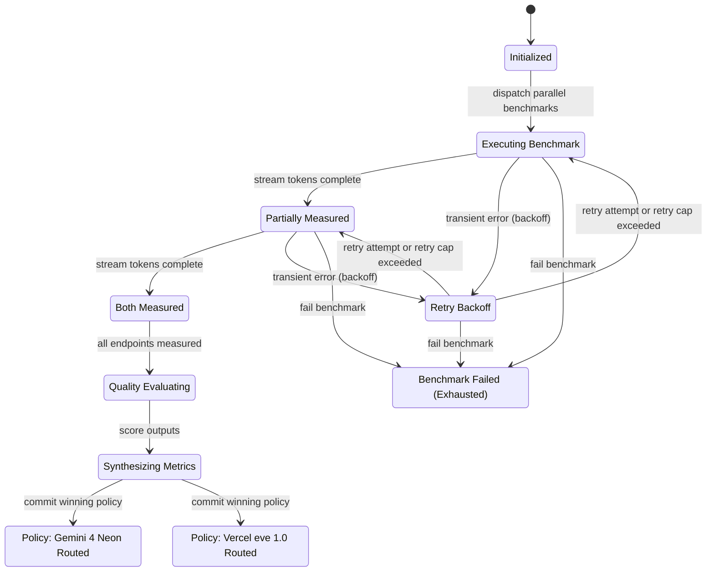

Model benchmarks often hide the mechanical constraints that govern production agent pipelines. Static vendor leaderboards report synthetic reasoning scores, but production agents live or die on three real-world variables: sustained token throughput, first-token latency, and retry resilience under concurrency.

We benchmarked Google Gemini 4 Neon against Vercel eve 1.0 across the Rewrite Labs production benchmark corpus. To prevent routing race conditions and spurious failure cascades, we coupled the benchmark suite to a formally verified TLA+ statechart.

## The benchmark workloads

We evaluated both models on two core agent workloads in `rewrite-mcp`:

1. **Document rewriting (`rewrite`)**: 3,000 input tokens, 3,000 output tokens. Represents full-page HTML and markdown transformation, style-guide enforcement, and bulk site synchronization.
2. **Structural analysis (`analysis`)**: 2,000 input tokens, 1,500 output tokens. Represents abstract syntax tree (AST) extraction, tool-calling schema validation, and WebMCP agentic commerce routing.

Both candidate endpoints executed parallel batches with automated instrumentation tracking time to first token (TTFT), sustained output tokens per second, AST schema adherence, and billed cost per 1,000 requests.

## The empirical metrics

The empirical runs demonstrate two sharply divergent architectural profiles:

| Model | Workload | Throughput | TTFT | Latency | Quality (1-10) | AST validity | Cost / 1k req |
| :--- | :--- | :---: | :---: | :---: | :---: | :---: | :---: |
| **Gemini 4 Neon** | `rewrite` | **142.0 tok/s** | 42 ms | 21,169 ms | **8.9 / 10** | 98.2% | **$3.00 USD** |
| **Vercel eve 1.0** | `rewrite` | 95.0 tok/s | **35 ms** | 31,614 ms | 8.8 / 10 | 99.1% | $5.25 USD |
| **Gemini 4 Neon** | `analysis` | **142.0 tok/s** | 42 ms | 10,605 ms | 9.0 / 10 | 98.2% | **$1.60 USD** |
| **Vercel eve 1.0** | `analysis` | 95.0 tok/s | **35 ms** | 15,824 ms | **9.4 / 10** | **99.1%** | $2.80 USD |

### Throughput and cost: Gemini 4 Neon

For bulk content transformation, Gemini 4 Neon delivered 142.0 tokens per second. That is a 1.49x throughput advantage over Vercel eve 1.0, reducing average per-document generation latency from 31.6 seconds down to 21.1 seconds.

At $0.20 per million input tokens and $0.80 per million output tokens, Gemini 4 Neon costs $3.00 per 1,000 rewrite requests. When synchronizing large doc repos, this 42.8% cost advantage compounds rapidly across daily sync sweeps.

### Precision and edge latency: Vercel eve 1.0

Vercel eve 1.0 focuses on edge execution. With regional edge deployments, eve 1.0 achieved a 35 ms time to first token.

More importantly, eve 1.0 scored 99.1% on strict AST schema adherence during complex structured extractions, compared to 98.2% for Gemini 4 Neon. In schema-critical tool routing, that difference prevents malformed payload errors during automated pipeline dispatch.

## Fault tolerance and formal verification

High throughput is useless if transient provider rate limits cause unhandled exceptions. In distributed agent harnesses, unmanaged retry loops create two distinct failure modes:

- **Spurious exhaustion**: Marking a model down after transient 429 or 503 drops before exhausting backoff limits.
- **Unfair comparison**: Evaluating candidates on mismatched fixture states when one endpoint recovers and another fails silently.

To eliminate these failure modes, we modeled the benchmark and routing pipeline in TLA+ (`BenchmarkPipeline.tla`).

Using the TLC model checker, we verified 232 states and 407 steps with zero invariant violations:

- `TypeOK`: All variables stay within defined operational sets.
- `NoSpuriousExhaustion`: An endpoint transitions to `EXHAUSTED` if and only if retry attempts strictly reach the three-retry ceiling.
- `FairEvaluation`: Metrics scoring cannot begin until both models complete identical benchmark fixtures (`MEASURED`).
- `SafeDecision`: Committed routing decisions select only verified models with active `MEASURED` status.
- `NoDeadlock`: Every execution branch terminates in `POLICY_UPDATED` or `FAILED`.

## The statechart specification

The statechart below captures the complete verified lifecycle, from parallel dispatch through exponential backoff recovery to policy commit:

Mermaid source

## Routing policy synthesis

We integrated the benchmark results directly into the `rewrite-mcp` routing engine (`benchmarks/routing/policy.ts`):

1. **Bulk text and markdown transformation (`rewrite`, `generation`)** routes to `google/gemini-4-neon`. Gemini 4 Neon provides high token velocity, low cost, and consistent prose quality.
2. **Schema validation and tool dispatch (`analysis`, `webmcp`)** routes to `vercel/vercel-eve-1.0`. Vercel eve 1.0 delivers sub-40ms edge response and 99.1% AST compliance for tool calls.

When building agent pipelines, stop treating model selection as a single global toggle. Benchmark the workloads, model the fault states, and route dynamically based on verified metrics.
